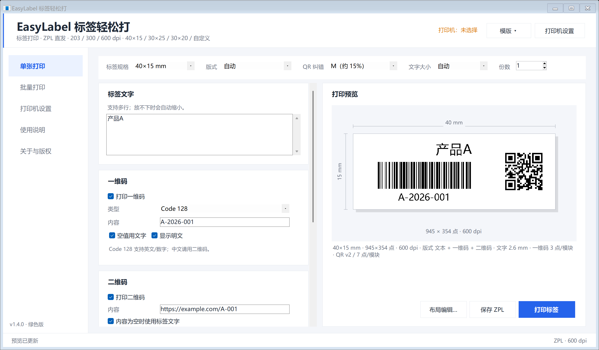
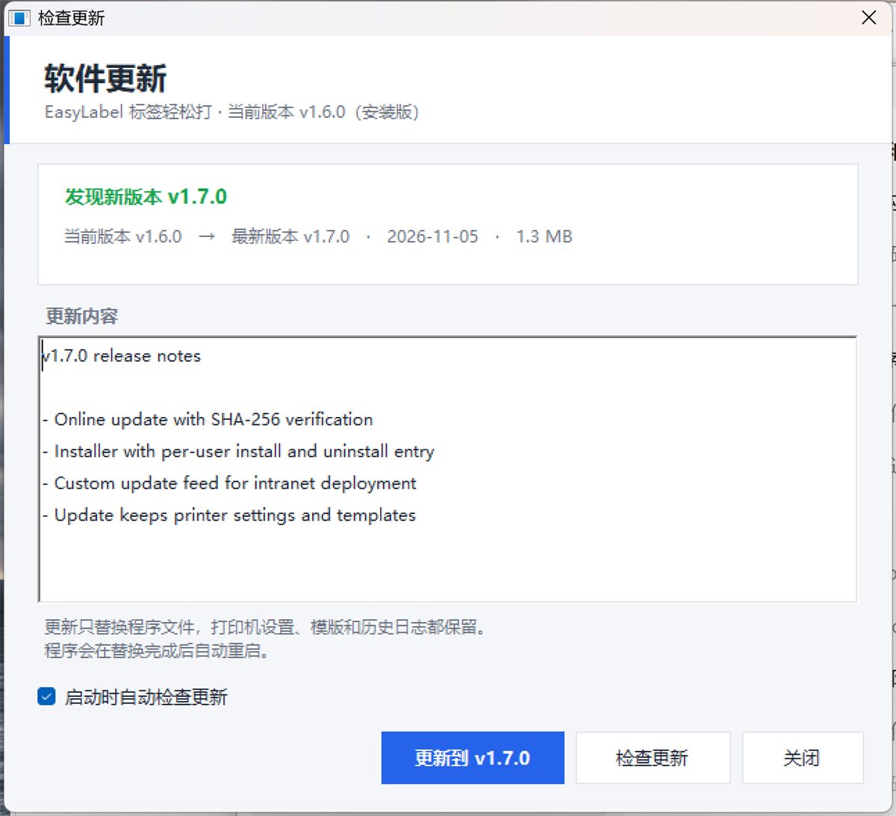
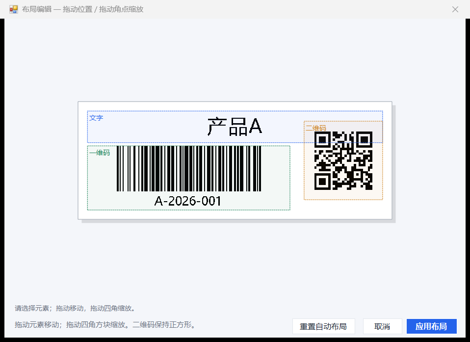
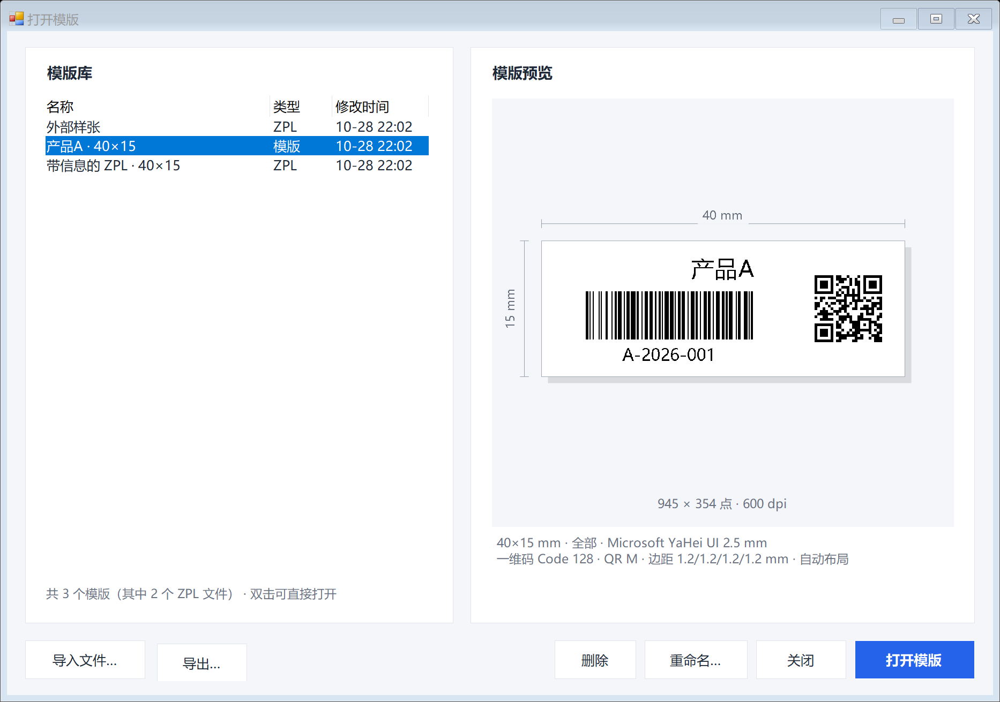
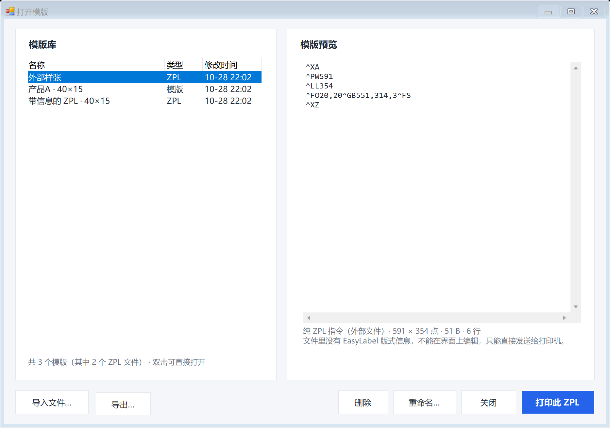
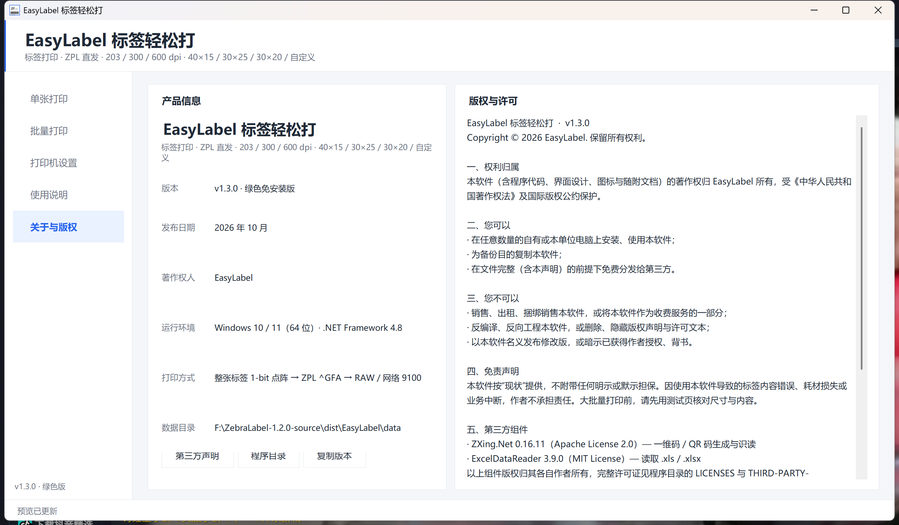

# EasyLabel 标签轻松打 v1.6.0

Windows 条码标签打印工具。支持 **40×15 mm**、**30×25 mm**、**30×20 mm** 和自定义尺寸，单张文本打印、Excel/CSV 批量打印，以及 Code 128 / Code 39 / EAN-13 一维码和 QR 二维码。

程序采用 **ZPL 直发**：把整张标签渲染成 1-bit 点阵，通过 `^GFA` 发送给打印机，不经过 Windows 驱动的页面缩放和重新排版。中文、条码、二维码的预览与实际打印使用同一张位图。

> **直接使用**：到 [Releases](https://github.com/yuguod/EasyLabel/releases) 下载最新版。
> 推荐 `EasyLabel-1.6.0-Setup.exe`（安装版，装完自动带开始菜单/桌面快捷方式、可在“应用和功能”里卸载）；
> 也可以下载 `EasyLabel-1.6.0-win64.zip` 解压即用（绿色版）。仓库只存源码，构建产物和版本包不进 Git（见 [从源码构建](#13-从源码构建)）。



---

## 1. 系统要求

- Windows 10 / Windows 11（64 位）
- .NET Framework 4.8（Windows 10 1903+ 和 Windows 11 已内置）
- 支持 ZPL II 的标签打印机（203 / 300 / 600 dpi 均可）
- 以下任一种连接方式：
  - 已安装打印机厂商的 ZPL 驱动并创建 Windows 打印队列；
  - 打印机网络可达，使用 IP:9100 直连（无需安装驱动）。

> 两种安装方式都不需要管理员权限：安装版默认装到当前用户目录，绿色版解压即用。首次运行若出现 SmartScreen 提示，选择“更多信息 → 仍要运行”。

---

## 2. 安装版与在线更新

### 安装版

运行 `EasyLabel-1.6.0-Setup.exe`：

1. 安装目录默认 `%LOCALAPPDATA%\Programs\EasyLabel`（当前用户，不需要管理员权限）。也可以改成任意目录；填 `C:\Program Files\...` 时安装程序会自动请求管理员权限，并改为“所有用户”安装（注册表写 HKLM、快捷方式放进公共开始菜单）。
2. 可选“创建桌面快捷方式”“安装完成后启动”。
3. 安装完成后：
   - 开始菜单出现 **EasyLabel 标签轻松打** 与 **卸载 EasyLabel**；
   - “设置 → 应用 → 已安装的应用”里能看到并卸载；
   - 设置、日志、模版存放在 `%APPDATA%\EasyLabel`，与程序目录分开，卸载时默认保留。

无人值守部署（IT 批量装）：

```bat
EasyLabel-1.6.0-Setup.exe /S /D="D:\Tools\EasyLabel"
EasyLabel-1.6.0-Setup.exe /uninstall /S
```

`/S` 静默安装（默认目录）、`/D=` 指定目录、`/uninstall` 卸载；静默卸载会结束正在运行的程序并保留用户设置。

### 在线更新

三种入口，效果相同：

- 点左侧栏底部的版本号（`v1.6.0 · 安装版`）；
- “关于 → 检查更新”；
- 启动时自动检查（默认开启，每天最多一次，可在“打印机设置 → 软件更新”关闭）。

流程：读取更新清单 → 比较版本 → 下载更新包 → **校验 SHA-256** → 解压 → 由 `EasyLabelUpdater.exe` 等主程序退出后替换文件并重启。打印机设置、模版、日志都不受影响。

发现新版本时界面如下：



### 自建更新源（内网）

默认清单地址是仓库根目录的 `update.json`（raw.githubusercontent.com）。内网无法访问外网时，把 `update.json` 和更新包放到内部 Web 服务器，然后在“打印机设置 → 软件更新”把“更新地址”改成清单 URL 即可；留空恢复默认。

清单格式（`build.ps1` 会自动生成一份到 `dist/update.json`）：

```json
{
  "version": "1.6.0",
  "releaseDate": "2026-10-28",
  "url": "https://example.com/easylabel/EasyLabel-1.6.0-update.zip",
  "sha256": "（更新包的 SHA-256，小写；留空则跳过校验）",
  "size": 1234567,
  "mandatory": false,
  "notes": "更新说明，支持 \n 换行"
}
```

也支持直接指向 GitHub Releases API（`.../releases/latest`）：程序会自动读取 `tag_name`、`body`，并优先选择文件名带 `update` 的 zip。

### 更新包与版本包的区别

| 文件 | 用途 | 是否含 `portable.flag` |
|---|---|---|
| `EasyLabel-<版本>-Setup.exe` | 安装版（内嵌更新包） | — |
| `EasyLabel-<版本>-win64.zip` | 绿色版 | 是 |
| `EasyLabel-<版本>-update.zip` | 在线更新（安装版与绿色版共用） | 否 |

更新包故意不带 `portable.flag`：否则安装版更新一次就“变回”绿色版，把设置写到程序目录里。

---

## 3. 文件说明

```text
EasyLabel.exe               主程序（依赖已内嵌）
EasyLabel.exe.config        .NET Framework 4.8 启动配置
EasyLabelUpdater.exe        在线更新的替换程序（主程序退出后覆盖文件并重启）
Uninstall.exe               卸载程序（仅安装版有，就是安装程序的一份副本）
portable.flag               便携模式标记：设置/日志保存在 data 目录（仅绿色版有）
samples/                    示例 Excel、CSV、ZPL、预览图
docs/                       界面截图
README.md                   本说明
THIRD-PARTY-NOTICES.txt     开源组件说明
LICENSES/                   开源许可证全文
```

`EasyLabelUpdater.exe` 是必需的：Windows 不允许正在运行的 exe 覆盖自己，更新必须由一个独立进程在退出后接手。删掉它也能用，程序会退化为“改名旧 exe 再写入”的方式，但成功率受文件占用影响。

### 便携模式

存在 `portable.flag` 时：

- 设置：`data\settings.xml`
- 日志：`data\logs\app-YYYYMMDD.log`
- 模版：`data\templates\*.elbl`

删除 `portable.flag` 后，设置、日志和模版改存到 `%APPDATA%\EasyLabel`。程序不会把标签正文写入日志。
（更名前版本保存在 `%APPDATA%\ZebraLabel`，首次启动时会自动复制到新目录。）

---

## 4. 快速开始

1. 双击 `EasyLabel.exe`。
2. 打开“打印机设置”：
   - Windows 队列：选择标签打印机对应的队列；
   - 网络直连：勾选“网络直连”，填写打印机 IP，端口默认 9100。
3. 确认“打印分辨率”与实际机器一致：**默认 600 dpi**，也支持 203 / 300 dpi。
4. 回到“单张打印”，输入文字；需要时勾选一维码/二维码。
5. 点击“打印标签”。

首次使用建议先到“打印机设置”点击 **打印测试页**，用尺子核对实际尺寸。

---

## 5. 单张打印

- **标签文字**：支持多行，自动换行；可用“文字大小（mm）”指定字号。
- **一维码**：
  - Code 128（默认）：英文、数字、常用 ASCII 符号；
  - Code 39：A-Z、0-9 和 `- . 空格 $ / + %`，自动转大写；
  - EAN-13：输入 12 位自动补校验位，或输入 13 位并校验。
- **二维码**：QR Code，UTF-8，支持中文、网址、换行。
- 条码/二维码内容留空时，可勾选“空值用文字”自动使用标签文字。
- “显示明文”控制一维码下方是否打印可读字符。
- 顶部可切换 **标签规格 / 版式 / QR 纠错 / 文字大小 / 份数**，右侧实时预览。
- “标签规格”内置 **40×15、30×25、30×20 mm**，并提供“自定义…”尺寸（5–300 mm）。
- “文字大小”支持“自动”或 1.5–10 mm。指定字号后如果当前版式放不下，程序会自动缩小并在预览下方提示实际字号。
- “高级版式”可设置 **字体族、字体加粗**、**上/下/左/右四边距**、条码高度比例、二维码大小比例。
- **布局编辑**：单张和批量页均可打开“布局编辑…”，拖动文字/一维码/二维码改变位置，拖动四角改变大小；二维码保持正方形。
- 应用布局后，预览、打印和保存 ZPL 都使用同一份位置/尺寸；切换标签规格、版式或启用/关闭码类型会回到自动布局。

### 版式说明

| 规格 | 纯文本 | 文本 + 一维码 | 文本 + 二维码 | 文本 + 一维码 + 二维码 |
|---|---|---|---|---|
| 40×15 mm | 2–3 行 | 标题 + 条码 + 明文 | 左文右码 | 仅短内容，空间很紧 |
| 30×25 mm | 3–5 行 | 标题 + 条码 + 明文 | 上文下码 | 文字 + 条码 + QR |
| 30×20 mm | 3–4 行 | 标题 + 条码 + 明文 | 上文下码 | 紧凑，建议短内容 |
| 自定义 | 按尺寸自适应 | 按尺寸自适应 | 按尺寸自适应 | 按尺寸自适应 |

程序会优先保证可扫描性。内容放不下时会明确报错，不会悄悄截断。

### 布局编辑

1. 在单张页或批量页点击 **“布局编辑…”**。
2. 拖动元素边框移动位置；拖动四角的白色方块缩放大小。
3. 二维码始终保持正方形；文字框变小时会自动换行/缩小。
4. 点击 **“应用布局”** 后，当前预览、打印和保存 ZPL 都使用新布局；“重置自动布局”可恢复。
5. 切换标签规格、切换版式，或勾选/取消一维码/二维码时，会回到自动布局，避免旧坐标错位。

布局编辑结果只作用于当前这次打印/本次运行；重新启动程序后默认回到自动布局。



### 边距与字体

- “打印机设置 → 默认版式”可设置默认字体、**默认是否加粗**、默认字号和 **上/下/左/右四边距**。
- 单张页和批量页的“高级版式 / 批量版式”中也可以分别调整，修改后立即反映到预览。
- 边距范围 0–20 mm；四边距之和超过标签尺寸时，预览会提示无可用空间。
- 字体使用 Windows 已安装字体；中文推荐 **Microsoft YaHei UI / Microsoft YaHei / SimHei / SimSun**。
- 勾选“字体加粗”后只加粗标签正文，一维码下方明文保持常规字重，便于扫描。
- 选择 `Segoe UI` 或 `Arial` 时，中文可能由系统回退字体显示；正式中文标签建议使用微软雅黑。
- 自定义尺寸宽度上限按常见 4 英寸机型约 **104 mm** 限制；高度可到 300 mm。

---

## 6. 模版（保存 / 打开）

做好的标签花样（规格、版式、字体、边距、布局编辑后的位置、文字/条码内容）可以整份存成模版，下次一键调出，不用再逐个调参数。

1. 调好一张标签，点页头右上角的 **“模版 ▾” → “将当前页面保存为模版…”**。
2. 给模版起个名字（例如“产品A · 40×15”），确定。
3. 以后再点 **“模版 ▾”**，最近 8 个模版会直接列在菜单里，点一下即可恢复；也可以选 **“打开模版…”** 打开模版库，左侧挑选、右侧预览，双击或点“打开模版”应用。

模版里保存的内容：

- 标签规格（内置尺寸或自定义尺寸）；
- 版式、一维码类型、QR 纠错等级、是否显示明文、文字对齐；
- 字体、字号、加粗、四边距、条码高度 %、二维码 %；
- **布局编辑**得到的自定义位置/尺寸（打开后保持不变，不会被重置为自动布局）；
- 一组示例文字/条码/二维码内容和份数。

使用规则：

- 在 **单张打印** 页打开模版：版式和示例内容一起恢复，直接改文字就能打印。
- 在 **批量打印** 页打开模版：只套用版式，不动表格里已导入的数据。
- 在设置/说明/关于页打开模版：自动切回单张页再应用。
- 同名保存会提示覆盖；模版名里的 `/ : * ?` 等字符在文件名中自动换成下划线，显示名保持原样。
- 模版库支持 **重命名、删除、导入文件、导出**；导出的 `.elbl` 文件可以直接发给同事，对方用“导入文件…”加进自己的模版库。
- 模版存放位置：便携模式 `data\templates\`，安装模式 `%APPDATA%\EasyLabel\templates\`（`设置 → 打开数据目录` 可进入）。删除模版文件即等于删除该模版。

### ZPL 文件（.zpl）

模版库除了 `.elbl`，也认 `.zpl`（ZPL 原生指令）：

- **保存为 ZPL 模版**：`模版 ▾ → “将当前页面保存为 ZPL 模版…”`。生成的文件本身就是一份完整的 ZPL，可以直接发给打印机，也可以交给其它 ZPL 工具；同时程序把规格、版式、布局等信息写进 `^FX` 注释（打印机会忽略注释），所以这个文件还能被 EasyLabel 再打开继续编辑。
- **外部 .zpl**：从别的系统拿到的 ZPL 没有内嵌信息，无法还原成可编辑的版式。模版库会把它标成 `ZPL`，右侧显示指令内容与点数尺寸，按钮变成 **“打印此 ZPL”**，选中即可直接发送到当前打印机；也可以用“导出…”另存到别处。
- `.elbl` 和 `.zpl` 可以同名共存，列表的 **“类型”** 列会标出是模版还是 ZPL 文件。



选中外部 `.zpl` 时右侧直接显示指令内容，主按钮变成“打印此 ZPL”：



---

## 7. Excel / CSV 批量打印

1. 打开“批量打印”，点击“导入 Excel/CSV”。
2. 选择 `.xlsx`、`.xls`、`.xlsm` 或 `.csv`。
3. 在导入窗口：
   - 选择工作表；
   - 勾选/取消“首行为标题行”；
   - 映射“文本列 / 一维码列 / 二维码列”（可选择“（无）”）。
4. 确认预览后点击“导入”。
5. 在表格中可直接修改内容、勾选要打印的行。
6. 点击工具栏“打印”。

### Excel 格式建议

| 文本 | 条码 | 二维码 |
|---|---|---|
| 产品A | A-2026-001 | https://example.com/A-001 |
| 产品B | B-2026-002 | https://example.com/B-002 |

- 每行打印一张（份数在工具栏统一设置）。
- 条码/二维码列为空时，勾选“空值时用文本补齐”会用文本列生成。
- **前导零**：建议把条码列设置为“文本”，否则 Excel 会把 `000123` 存成 `123`。程序会尝试识别 `000000` 这类纯零数字格式，但不能覆盖所有自定义格式。
- “仅勾选行”默认开启；取消后打印全部行。
- 程序会在发送前逐行校验，失败行不会发送；可先根据提示修正。

示例文件：`samples/sample-data.xlsx`、`samples/sample.csv`。

---

## 8. 条码/二维码规则

- 一维码不支持中文/全角字符；中文请使用二维码或纯文本。
- 40×15 标签空间很小：
  - 一维码模块可能只有 **1 点**，程序会给出警告；
  - 如果扫描困难，建议改用 30×25、缩短内容、使用 300 dpi，或降低打印速度。
- QR 内容越长，版本越高、模块越小；40×15 上建议使用短网址或短编号。
- 条码/二维码内容中的 `^`、`~` 等字符不会破坏 ZPL，因为整张标签是点阵图。

---

## 9. 打印机设置与校准

### DPI

| 规格 | 203 dpi | 300 dpi | 600 dpi |
|---|---|---|---|
| 40×15 mm | 320×120 点 | 472×177 点 | 945×354 点 |
| 30×25 mm | 240×200 点 | 354×295 点 | 709×591 点 |
| 30×20 mm | 240×160 点 | 354×236 点 | 709×472 点 |

DPI 必须与打印机实际分辨率一致，否则标签会整体偏大/偏小。本工具默认 **600 dpi**；选择打印队列时会尝试从队列名称（如 `XXX-600dpi`）识别，最终以设置页选择为准。

> 如果打印内容只占标签的一小块、文字整体明显偏小，优先怀疑 DPI 选错：600 dpi 机器选 203 dpi 会放大，选 300 dpi 也会偏移。打印测试页后测量外框：40×15 的外框应约 40 mm。

### 介质

- 间隙纸/标签纸：默认 `^MNY`（Web 感应）。
- 连续纸：在设置中切换为“连续纸”，使用 `^MNN`。
- 如果走纸不准、跳标签，请在打印机面板执行介质校准（按键组合见打印机手册），并确认间隙传感器类型。

### 浓度与速度

- 浓度默认 `0`，范围 `-30 ~ 30`；偏浅调大，偏深调小。
- 速度默认 `4 ips`，范围 `2 ~ 14`；小标签/细条码建议降低速度。
- 这些参数通过 `^MD` / `^PR` 随每个作业发送，不修改打印机持久配置。

### 测试页

“打印机设置”→“打印测试页”会打印：

- 标签外框和角标；
- 标签规格、DPI、时间；
- 一个测试二维码；
- 可直接用尺子核对 40×15 / 30×25 的实际尺寸。

发送测试页后，程序会弹出提示，告诉你如何根据外框宽度判断 DPI 是否选错。

---

## 10. 保存 ZPL / 离线排查

- 单张/批量页面都有“保存 ZPL”。保存的文件是 ASCII ZPL，可直接发送给打印机，或用 Labelary 等 ZPL 预览工具检查。
- 如果打印队列不可用，可先保存 ZPL，再通过其他 ZPL 工具或网络 9100 发送。
- 注意：ZPL 是 **RAW** 数据，要求队列/打印机支持 ZPL II；不支持 EPL 或纯图形驱动的打印机。

---

## 11. 常见问题

**点击打印报“无法打开打印机”**

- 检查队列名称是否存在、是否离线、Spooler 是否运行。
- 可先打印测试页；或改用网络直连 IP:9100。
- 本程序不依赖 Adobe PDF / Microsoft Print to PDF 等虚拟打印机。

**打印空白或乱码**

- 确认队列使用打印机厂商提供的 ZPL 驱动。
- 尝试保存 ZPL 文件，用其他 ZPL 工具发送，排除队列问题。

**标签整体偏大/偏小，文字非常小**

- 90% 是 DPI 选错。600 dpi 机器应选择 600；错选 203 会放大、300 会偏移。
- 确认标签规格选择正确（40×15 / 30×25 / 30×20 / 自定义）。
- 如果整体尺寸正确但文字仍小：在单张页顶部把“文字大小”从“自动”改成 4–7 mm；如果同时有文字+条码+二维码，40×15 的文字区域很小，建议改用 30×25、30×20 或纯文本版式。

**条码扫描不出来**

- 40×15 的“全部”版式非常紧，建议缩短内容或改用 30×25。
- 降低打印速度、调整浓度；检查标签纸是否反光/太亮。
- 一维码模块只有 1 点时，扫描成功率会下降；程序会警告。

**中文显示为方框**

- 本程序将中文栅格化，不依赖打印机内置字体；正常不会出现。
- 如仍异常，请确认发送的是本程序生成的 ZPL，而不是驱动重新排版。

**Excel 前导零丢失**

- 把条码列设置为“文本”后重新导入。
- 或使用纯零数字格式（如 `000000`），程序会尝试保留。

**导入后表格为空**

- 检查是否选择了正确的工作表、标题行和列映射。
- 检查数据行是否全部为空。

---

## 12. 数据与隐私

- 不含遥测、埋点或使用统计；标签内容与导入的表格数据只在本机处理。
- 检查更新时会向更新地址请求 `update.json`（只有版本号、包大小等发布信息），下载更新包时同样只访问该地址。除此之外程序不发起任何网络请求。
- 使用“网络 9100”直连打印时，ZPL 数据仅发送到您指定的打印机地址。
- 日志只记录启动、打印机、标签数量、错误信息，不记录标签正文。
- 设置与日志位置见“便携模式”一节。
- “关于”页中可查看版权声明、许可条款与开源组件说明。

---

## 13. 从源码构建

环境：

- Windows 10/11 x64
- .NET Framework 4.8
- 项目内 `tools/roslyn/csc.exe`（Roslyn 编译器）
- `libs/zxing.dll`、`libs/ExcelDataReader.dll`（已随源码提供）
- GitHub CLI（`gh`，仅发布新版本时需要，构建不需要）

构建：

```powershell
powershell -NoProfile -ExecutionPolicy Bypass -File .\build.ps1 -Tests
```

输出：

- `dist/EasyLabel/EasyLabel.exe`（单文件，依赖已内嵌）
- `dist/EasyLabel/EasyLabelUpdater.exe`（在线更新的替换程序）
- `dist/EasyLabel-1.6.0-win64.zip`（绿色版）
- `dist/EasyLabel-1.6.0-update.zip`（在线更新包）
- `dist/EasyLabel-1.6.0-Setup.exe`（安装版，更新包已内嵌）
- `dist/update.json`（更新清单，含 SHA-256 与包大小）
- 构建脚本会把上述产物同步归档到 `releases/`，以后每个版本都保留，不覆盖旧包。

版本号只在 `src/AssemblyInfo.cs` 里维护，包名、安装程序标题、更新清单都由脚本读取，不需要改多地。想另存一份产物（例如当前目录里的程序正在运行）可以指定输出目录：

```powershell
.\build.ps1 -OutDir dist\verify
```

发布新版本时的顺序：

1. 改 `src/AssemblyInfo.cs` 的版本号，更新 `update.json` 里的 `notes` 与 `releaseDate`；
2. `.\build.ps1 -Tests`：编译、跑测试、产出三种包，并生成带 SHA-256 的 `dist/update.json`；
3. 把 `dist/update.json` 覆盖到仓库根目录（客户端默认从这里取清单），连同代码一起提交；
4. `.\publish.ps1`：打标签、推送、建 Release、上传 4 个附件。

第 4 步依赖 GitHub CLI，装一次、登录一次即可：

```powershell
winget install --id GitHub.cli
gh auth login --hostname github.com
```

`publish.ps1` 可用的参数：

```powershell
.\publish.ps1                      # 发布 AssemblyInfo 里的版本号
.\publish.ps1 -DryRun              # 只检查并打印将要执行的命令，不动远端
.\publish.ps1 -Draft               # 发成草稿
.\publish.ps1 -Version 1.7.0       # 指定版本（须已有对应产物）
.\publish.ps1 -NotesFile docs\v1.7.0.md   # 用独立文件写更新说明
```

脚本自己会做这些事：

- 检查 `releases/` 里 4 个产物是否齐，缺哪个直接报出来；
- 校验 `update.json` 的 `version`、`sha256` 与更新包是否一致、`url` 是否指向本次 tag——不一致就中止，避免发出“下载完校验不过”的更新包；
- 版本号默认读 `src/AssemblyInfo.cs`，与 `build.ps1` 同源；
- 标签已存在但指向别的提交时中止，并给出 `git tag -d` / `git push origin :refs/tags/…` 的修复命令；若标签只是比 HEAD 落后（例如发布后又提交了文档），则只刷新附件与说明，不动标签；
- Release 已存在时改为覆盖附件（`--clobber`）并刷新说明，所以重跑是安全的；上传失败会自动重试 3 次；
- 发布说明由 `update.json` 的 `notes` 生成，自动补上文件表格与 SHA-256；
- 结束时用 `gh release view` 回读线上附件数量与大小，附上 Release 地址。

测试：

```powershell
.\tests\TestRunner.exe
```

测试包括：点阵尺寸、一维码/QR 回读、40×15/30×25/30×20 渲染、自定义尺寸、四边距、字体、**加粗**、**自定义元素布局**、**模版保存/读取/重命名/删除/导入导出**、**ZPL 模版往返与外部 .zpl 直发**、Excel/CSV 导入、ZPL 结构、**更新清单解析与版本比较**，以及 Labelary 预览验证。


---

## 14. 第三方组件与许可

- **ZXing.Net 0.16.11** — Apache License 2.0，一维码/QR 生成与识读，版权归 ZXing.Net authors 所有。
- **ExcelDataReader 3.9.0** — MIT License，读取 `.xls` / `.xlsx`，版权归 ExcelDataReader contributors 所有。

两个组件以未经修改的二进制形式随程序分发，完整许可文本见 `LICENSES/`，归属与履行说明见 `THIRD-PARTY-NOTICES.txt`，也可在程序内“关于”页查看。

---

## 15. 版权

Copyright © 2026 yuguod. 保留所有权利。

作者：yuguod　·　项目地址：<https://github.com/yuguod/EasyLabel>

本软件（含源代码、目标程序、界面设计、图标与随附文档）由作者独立开发，著作权归作者所有，受《中华人民共和国著作权法》《计算机软件保护条例》与《伯尔尼保护文学和艺术作品公约》保护。

- **可以**：在自有或本单位任意数量的电脑上安装运行；为备份目的复制；以原始未修改的形式（含本声明与第三方许可证）免费分发。
- **不可以**：销售、出租或捆绑进收费产品；发布基于源码修改的衍生版本；删除版权声明与许可文本；暗示获得作者授权或背书。

源代码在 GitHub 上公开，仅为便于查阅、审计与交流——**公开可见不等于开源授权**，除上述许可外未授予其他权利。本软件按“现状”提供，在法律允许的最大范围内不提供任何担保；依法不得排除的责任（如故意或重大过失造成财产损失、人身损害）不受免责条款限制。

完整条款见仓库根目录 [`LICENSE`](LICENSE) 与程序内“关于”页。



---

## 16. 版本

**v1.6.0** — 新增 **安装版与在线更新**：`EasyLabel-1.6.0-Setup.exe` 单文件安装（默认装到当前用户目录、免管理员，自动创建开始菜单/桌面快捷方式并注册“应用和功能”卸载项，支持 `/S`、`/D=`、`/uninstall` 无人值守）；程序内新增“软件更新”：左侧栏版本号、“关于 → 检查更新”或启动时自动检查（每天一次，可关），下载后校验 **SHA-256**，由 `EasyLabelUpdater.exe` 在主程序退出后替换文件并重启，设置/模版/日志不受影响；支持把更新源指到内网自建地址。打包新增 `update.zip`（不含 `portable.flag`）与 `update.json`。  
**v1.5.1** — 版权页改为“关于”：著作权人改为作者 `yuguod`，新增可点击的项目地址，移除“打印方式/数据目录”两行；许可条款重写（明确著作权自动产生与法律依据、法定例外、不可排除的责任、第三方组件的 Apache-2.0 第 4 条履行说明），仓库补 `LICENSE` 全文。  
**v1.5.0** — 模版支持 **ZPL 格式文件**：新增“将当前页面保存为 ZPL 模版…”，生成的 `.zpl` 既能直接发给打印机，也在 `^FX` 注释里带上版式信息，可再打开继续编辑；模版库同时列出 `.elbl` 与 `.zpl`（新增“类型”列），外部 `.zpl` 显示指令内容与点数尺寸并支持一键直发、导入、导出、改名。  
**v1.4.0** — 新增 **模版功能**：页头“模版”菜单可把当前规格、版式、字体、边距、自定义布局和示例内容保存为模版（`.elbl`），下次一键打开；模版库支持预览、重命名、删除、导入/导出文件，批量页打开模版只套版式不动数据。同时修复 200% 缩放下页头“模版/打印机设置”和状态栏右侧文字被挤出窗口的问题。  
**v1.3.0** — 更名 **EasyLabel 标签轻松打**：程序名、窗口标题、打印作业名、设置目录统一改为 EasyLabel（旧设置自动迁移）；界面文案去掉打印机品牌与型号；新增“关于与版权”页（产品信息、版权声明、使用许可、第三方组件、商标与免责）。  
**v1.2.0** — 新增布局编辑：文字/一维码/二维码可拖动位置、拖动四角缩放；单张和批量均支持，打印与 ZPL 使用同一布局。旧版本保留在 `releases/`。  
**v1.1.1** — 文字编辑新增“字体加粗”，支持单张、批量和设置页默认值；加粗只作用于标签正文。  
**v1.1.0** — 适配 600 dpi 机型；新增 30×20 mm 与自定义尺寸；新增上/下/左/右独立边距；支持字体族与字号设置；设置页默认值同步。  
**v1.0.1** — 修复字号控制：改为“文字大小（mm）”并接入当前单张/批量打印；设置页默认字号保存后同步到当前标签；测试页增加 DPI 自检提示。  
**v1.0.0** — 首个可用版本：单张、Excel/CSV 批量、Code128/Code39/EAN-13、QR、ZPL 直发、测试页、便携设置与日志。
